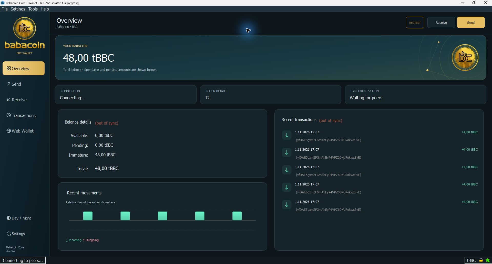

# Babacoin Core V2

**A more capable, accessible, non-custodial BBC wallet on the existing Babacoin blockchain.**

[Releases](https://github.com/babacoinbbc/babacoin/releases) ·
[Build and test results](https://github.com/babacoinbbc/babacoin/actions) ·
[Migration and settings](doc/v2-migration.md) ·
[Platform support](doc/platform-support.md)

## V2.0.0 Mainnet Release

V2 combines a redesigned day/night desktop wallet, safer wallet handling and a
larger, test-gated platform matrix. Download the matching package from the
[V2.0.0 mainnet release page](https://github.com/babacoinbbc/babacoin/releases/latest).
Read its release status, checksums, source manifest and migration notes first.
Release assets are assembled only after every required platform job passes.

**Mandatory network upgrade:** all validating wallets and services must upgrade
promptly on release, not wait for block 1,250,000. V2 allows early 2,000,000 BBC
Smartnode registration without an opening block; V1 can reject its first block.
The 1,800,000 BBC tier stops qualifying for rewards at block 1,250,000.
Read the [exchange, pool and wallet upgrade notice](doc/release/mandatory-network-upgrade.md).

This is the final V2 build, not a claim that all historical node versions
agree or that software is free of defects. The Releases page retains V1 and the current V2 release. Publishing a release does not remotely upgrade nodes or
activate a new blockchain. Production adoption and network-rule changes require
separate operator coordination and review.

## What changes in V2



[View the day theme](doc/images/v2-wallet-day.jpg)

*Windows development preview with isolated regtest data and test coins. The
supplied gold artwork is retained unchanged and rendered at the sidebar's
display density. The final V2 build does not display the old RC prerelease notice.*

- **Day and night themes:** persistent appearance, keyboard switching and a
  gold-and-teal balance panel, high-DPI line icons, clearer transaction rows
  and a bounded recent-activity view. Decorative artwork adds no animation
  timers or remote image downloads.
  Theme loading normalizes Windows line endings and safely filters multiple
  platform-specific CSS sections, with a regression test for both behaviors.
- **Clear financial information:** the existing balance calculations, pending,
  immature and watch-only fields remain intact. Activity bars describe only the
  displayed recent transactions; they are not price or investment-return charts.
- **Live network overview:** connection state, validated block height and
  synchronization cards update from the client model. Header-only heights do
  not replace validated heights, and paused/peerless wallets do not claim to be
  up to date. Existing synchronization warnings remain visible.
- **Visible startup checks:** the main window opens with a dedicated startup
  panel before backend initialization finishes. It shows the current phase,
  elapsed time and data directory, with diagnostics and safe cancellation.
  Rescans show a two-decimal percentage calculated from the actual block
  interval, checked/target blocks and current/target heights. Unknown-duration
  phases use an indeterminate bar. Financial controls stay unavailable until
  required checks succeed; verification and block validation remain enabled.
- **Windows setup wizard:** a per-user installer bundles the exact tested EXEs,
  DLLs and Qt plugins, with Start menu and desktop shortcuts and an optional
  existing data-folder choice. It refuses running wallets and installation into
  wallet data. Reinstallation and uninstall preserve wallet fixtures in tests.
  Installation does not start a wallet or rescan automatically.
- **Readable amounts:** balances and transaction lists use the operating system's
  decimal and thousands separators, including `1.234.567,89 BBC` in Turkish and
  `1,234,567.89 BBC` in US English. Amount calculations retain integer precision.
- **Responsive history:** large transaction lists load in bounded batches with
  visible progress; export waits until history is complete. Splash artwork uses
  a fixed logical rectangle so high-DPI scaling cannot overlap the title.
- **Safer persistence:** interrupted startup rescans retain the previous checkpoint
  and retry instead of skipping unread transactions; corrected disk-index field decoding, strict BDB 4.8.30
  selection, fail-closed backups and test reports that reject premature exits.
- **Correct peer attribution:** invalid mixed-sender DKG messages no longer blame
  a single unrelated sender without the individual checks.
- **Broader packaging:** Ubuntu LTS, Debian, Windows and both Mac architectures,
  plus explicit ARM64 and Windows-on-ARM emulation validation targets.
- **Optional Explorer discovery:** a live desktop Network preference fetches
  bounded HTTPS peer hints from the official Explorer. Public IP/port checks,
  network-group limits and existing peer validation apply; it is off by default.
- **Smartnode setup wizard:** current-height collateral checks, a separate
  collateral transfer review, local transaction preparation, exact fee review
  and explicit registration confirmation. The operator secret stays on the server.
- **Web Wallet tab:** open the separate Web Wallet in your default browser;
  local keys and wallet files are never automatically imported. Embedded browser
  support is future work; test-network previews disable the mainnet launch button.
- **Isolated previews:** every package includes a launcher that creates new
  regtest data and separate GUI preferences with external P2P disabled.

The wallet remains a full-node client. Blockchain synchronization, wallet loading
and a requested rescan can take substantial time; a prettier interface does not
remove those safety checks.

## Platform coverage

| Platform | Package / validation scope |
|---|---|
| Ubuntu 18.04, 20.04, 22.04, 24.04, 26.04 LTS | Separate x86_64 and ARM64 userspaces; full native build/test gate |
| Debian 12 and 13 | Separate x86_64 and ARM64 userspaces; full native build/test gate |
| Raspberry Pi OS 64-bit | Debian 12/13 ARM64 compatibility target; physical Pi hardware/display testing remains separate |
| Windows x64 | Native UCRT64 build; tests on a separate clean Windows runner |
| Windows 11 ARM64 | The **same x64 Windows package under emulation**; no native ARM64 Windows executable is claimed |
| macOS Intel / Apple Silicon | Separate native builds/tests; bundled GUI, ad hoc signed |

The [support matrix](doc/platform-support.md) distinguishes configured targets,
actual completed jobs, hardware testing and unsupported systems. There is no
universal binary for every operating system. Android/iOS, 32-bit Windows/ARM,
FreeBSD and other systems are roadmap work, not shipped support. Old operating
systems still require appropriate vendor security maintenance.

## Windows package and DLL files

For the guided installation, download the release's
`babacoin-v2.0.0-windows-x86_64-setup.exe` and verify its `.sha256` file.
It installs for the current user without an administrator account. Leave the
normal data settings selected, or choose an existing data folder deliberately;
the program folder and wallet data folder must be separate. Close Babacoin
normally before upgrading. The installer refuses running wallets rather than
terminating them. The Finish-page launch option is unchecked by default.
`INSTALLER-MANIFEST.json` identifies the exact portable payload and source;
`INSTALLER-TESTS.json` records the matching x64 and ARM64-host installer tests.
Back up a production wallet before upgrading.

The portable alternative is the complete ZIP:
Download the complete Windows ZIP and extract **all** its contents into a new
application folder before starting `babacoin-qt.exe`. Keep the included DLLs and
the `platforms` folder beside the executable. The Windows wallet uses dynamic
Qt, Boost and other libraries; its EXE is not a standalone single-file package.
Moving only the EXE can produce missing-DLL errors, including `libabsl_*` or
`libboost_*` files. Create a shortcut to the EXE in its extracted folder instead
of copying the EXE to the desktop or an older installation.

Use the libraries from that exact verified release package. Do not download
individual DLLs from unrelated websites or mix files from different builds.
Application files belong in the application folder; keep wallet backups private
and follow the migration guide when selecting an existing data directory.

## Try the interface without touching a production wallet

Extract the package into a **new directory** and run:

- Windows: `TEST-WALLET.cmd`
- Linux/macOS: `bash TEST-WALLET.sh`

Each launch creates fresh temporary regtest data and GUI preferences. No
production wallet is copied or opened. Test coins have no mainnet value.
Use **Day / Night** or **Ctrl+Shift+L** to change appearance.

Directly starting `babacoin-qt` or the Mac application uses normal settings and
can open an existing wallet. Read [migration instructions](doc/v2-migration.md)
before doing that. Never put your real `wallet.dat` into a disposable test folder.

## Existing network, explicit rules

V2 retains the audited `main` network identity and the selected collateral
expiry height. It fixes payment selection at that boundary and supports early
registration of the final tier. These rules require a coordinated upgrade from
V1; retaining the same genesis does not make that upgrade optional.

An actual V1 data-directory trial exposed an incorrect historical founder
destination in the earlier main-branch source. V2 restores the published V1
destination before the existing 1,250,000 transition, with five public historical
coinbase regressions. Mainnet founder validation is enforced from its original
start; historical acceptance is not repaired by skipping those checks.

| Parameter | Existing mainnet value |
|---|---|
| Ticker | BBC |
| Proof of Work | GhostRider |
| Target block spacing | 120 seconds |
| P2P port | `6678` |
| RPC port | `17668`; keep RPC private |
| Genesis hash | `84de4877419c696744198422de2628087ae2270c73fb370ab4cfe2fe01061854` |
| Message start | `03 5d d7 2f` |
| Public-key / script / private-key version bytes | `25 / 102 / 205` |

The existing `main` source already differs from published V1. In particular:

| Existing rule | Schedule / behavior |
|---|---|
| Smartnode collateral | 2,000,000 BBC may be registered immediately; 1,800,000 BBC remains reward-eligible through 1,249,999 and expires at 1,250,000 |
| Founder destination schedule | Existing address change at block 1,250,000; enforcement must be read with the actual validation rules |
| Spork key rotation | Takes effect on upgrade, not through a new height gate |

All historical collateral tiers remain recorded so historical registrations can
still be decoded and validated. Registration validity and current payment
eligibility are different checks. V1 has no 2,000,000-BBC final tier. Do not infer
network-wide agreement from matching ports or a successful P2P handshake. The
upgrade deadline must precede the first 2,000,000 BBC registration, not merely
the old tier's later expiry. The wizard offers either payable tier before expiry.

**No automatic collateral top-up or coin movement is performed.** An existing
collateral UTXO cannot be enlarged by sending additional coins to its address.
Smartnode owners must use a separately reviewed registration/migration process.
ChainLocks and related protections also depend on active quorums and spork state;
never assume those protections are active solely because the software runs.

## Settings and data

Default data directories, unless `-datadir` or saved GUI preferences override them:

| OS | Default directory |
|---|---|
| Linux | `~/.babacoin/` |
| macOS | `~/Library/Application Support/BabaCoin/` |
| Windows | `%APPDATA%\BabaCoin\` |

Configuration belongs in `babacoin.conf`. Cookie authentication is available
for local RPC; never publish RPC credentials, seeds or private keys. Keep RPC
bound to loopback and do not expose it through the public P2P firewall rule.
Examples and the distinction between `-datadir`, `-conf` and `-uiconfigdir` are in
[the settings guide](doc/v2-migration.md).
See [Smartnode setup](doc/smartnode-setup.md) for the wizard's scope and recovery
steps. The new wizard is a self-operated, zero-operator-reward registration flow;
it does not deploy or administer a remote VPS.

The verified Linux download helper is optional and **fresh-install only**:

```sh
# Review the tagged source and select the release explicitly.
BBC_VERSION=v2.0.0 bash contrib/install.sh
```

It verifies the exact distribution/architecture package and SHA256, rejects
unsafe archives and writes a new user-owned installation directory. It does not
start a node, create a wallet, modify configuration, require sudo or alter a
firewall, service or OS security setting. Existing data/installations are refused.
Legacy automatic seed/OS-upgrade scripts now exit safely; see
[operator helpers](contrib/README.md). Never pipe an unreviewed installer into a shell.

## Validation and release integrity

The release gate builds the daemon, CLI, transaction utility and Qt GUI. It runs
343 core test cases, six Qt groups, transaction-utility and RPCAuth tests,
secp256k1 and UniValue suites, source-integrity checks, archive-safety tests and
fresh-wallet smoke tests. Platform logs record their exact source commit and
package versions. A failed target prevents release assembly.

The audit also exercised encrypted/unencrypted V1 test-wallet round trips,
backup restoration, message signatures, localhost-only P2P and bounded historical
block/UTXO comparisons. These are **bounded tests**, not complete chain validation
or a certification of every real wallet. Existing wallet files were not used as
build fixtures. See [validation notes](doc/wallet-desktop-validation.md).

Release files include `SHA256SUMS`, per-archive hashes and `RELEASE-MANIFEST.json`.
The assembler checks architecture, source revision and the complete expected
package set. Mac GUI applications are ad hoc signed and are not Apple notarized;
no Microsoft publisher certificate is claimed. Mac CLI tools retain documented
Homebrew dependencies. Linux packages record their runtime libraries and build
packages. Dependencies retain their [own licenses](doc/release/dependency-notices.md).

## Mission and development goals

Our goal is a capable, understandable, non-custodial BBC wallet that protects
users through explicit controls, transparent releases and compatibility testing.
We prioritize reliable recovery and clear network state over cosmetic claims or
promised financial returns.

1. **V2 foundation:** accessible day/night UI, safer persistence and backups,
   reproducible validation paths, platform-specific packages and English docs.
2. **Release confidence:** independent review, signed/notarized distribution,
   broader migration fixtures, physical Raspberry Pi testing and longer history
   replays. Signing requires the project's actual publisher credentials.
3. **Wallet capabilities:** improve hardware-wallet integration, offline signing,
   accessibility and transaction workflows after design and security review.
   Investigate a separately isolated embedded Web Wallet with supported browser
   engines and updated build tooling; V2 opens the system browser instead.
4. **Wider clients:** investigate mobile and additional OS targets with explicit
   threat models and real runtime tests. They are not advertised as delivered.
5. **Network evolution:** publish proposals, compatibility analysis, activation
   plans and operator guidance before changing consensus or governance rules.

Features become supported when implementation and tests exist. No investment
returns, exchange listings, mobile availability or network-wide migration are
promised by this roadmap.

## Build, contribute and review

- [Full and incremental blockchain bootstrap](doc/bootstrap.md)
- [Ubuntu build guide](doc/ubuntu-compatibility.md)
- [Desktop validation](doc/wallet-desktop-validation.md)
- [V2 release notes](doc/release/v2.0.0.md)
- [Short upgrade announcement](doc/release/v2-announcement.md)
- [Discord coin information](doc/community/discord-coin-information.md)
- [Contribution guide](CONTRIBUTING.md)

Use disposable build environments and `make check`. Do not disable tests to
obtain release artifacts or run source-build experiments on a production node.
The protected `main` branch requests independent approving review. Its existing
administrator exception remains enabled; owner-authorized main integration used
that exception. Passing CI does not establish independent human review.

Babacoin Core is distributed under the [MIT license](COPYING). Project resources:
[website](https://babacoin.network), [explorer](https://explorer.babacoin.network),
[repository](https://github.com/babacoinbbc/babacoin).
